# Rapport de TP : SGBD NoSQL
## MongoDB · Redis · ElasticSearch

**Étudiant :** Walid CHAKIB
**Formation :** ISIMA, filière F3
**Enseignant :** Lionel Antraigue
**Dépôt :** https://gitlab.isima.fr/wachakib/tp01-mongodb

---

## Sommaire

1. [Objectifs et architecture](#1-objectifs-et-architecture)
2. [TP1 : MongoDB, application CRUD](#2-tp1--mongodb-application-crud)
3. [TP2 : Redis, cache applicatif et tests de charge](#3-tp2--redis-cache-applicatif-et-tests-de-charge)
4. [TP3 : ElasticSearch, moteur de recherche](#4-tp3--elasticsearch-moteur-de-recherche)
5. [Problèmes rencontrés et solutions](#5-problèmes-rencontrés-et-solutions)
6. [Conclusion et apprentissages](#6-conclusion-et-apprentissages)
7. [Annexe : relancer le projet](#7-annexe--relancer-le-projet)

---

## 1. Objectifs et architecture

L'objectif de ces trois TP est de construire une petite application web d'administration du **catalogue des manuscrits de la bibliothèque du Patrimoine de Clermont Auvergne Métropole** (données open data), puis de l'enrichir progressivement avec trois technologies NoSQL :

| TP | Technologie | Rôle dans l'application |
|---|---|---|
| 1 | **MongoDB** | Stockage des documents (source de vérité) |
| 2 | **Redis** | Cache applicatif pour accélérer les lectures |
| 3 | **ElasticSearch** | Recherche plein texte tolérante aux fautes |

L'application est écrite en **PHP 8.3** avec **Twig** (templates) et **phpdotenv** (configuration). L'ensemble de l'environnement tourne dans **Docker** (`docker-compose.yml`) sous WSL2 / Ubuntu :

| Service | Conteneur | Port |
|---|---|---|
| Application PHP / Apache | `tpmongo-php` | 8080 |
| MongoDB | `tpmongo-mongodb` | 27017 |
| Mongo GUI | `tpmongo-mongo-gui` | 4321 |
| Redis | `tpmongo-redis` | 6379 |
| Redis Commander | `tpmongo-redis-commander` | 8081 |
| k6 (tests de charge) | `tpmongo-k6` | n/a |
| InfluxDB (stockage des résultats k6) | `tpmongo-influxdb` | 8086 |
| Grafana (visualisation) | `tpmongo-grafana` | 3000 |
| ElasticSearch 8.12 | `tpmongo-elasticsearch` | 9200 |
| Kibana | `tpmongo-kibana` | 5601 |
| Elasticvue | `elasticvue` | 8180 |

> CAPTURE 1 : `captures/01_docker_ps.png`**
> Le résultat de `docker ps --format "table {{.Names}}\t{{.Status}}"` montrant tous les conteneurs `Up`.

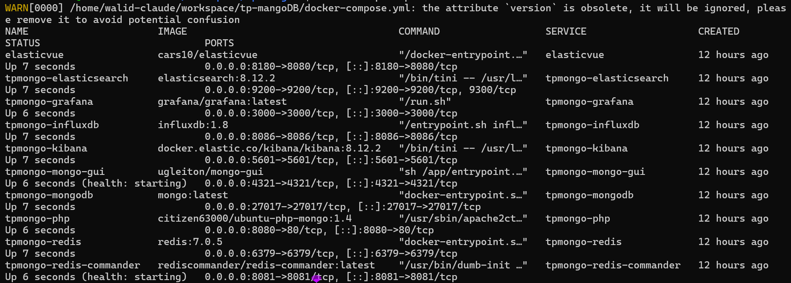

---

## 2. TP1 : MongoDB, application CRUD

### 2.1 Import des données

Le jeu de données (fichier JSON de 2818 manuscrits) a été téléchargé depuis le portail open data de Clermont Métropole puis importé avec `mongoimport`. Plutôt que d'installer les outils MongoDB sur la machine, nous avons utilisé le `mongoimport` **déjà présent dans le conteneur MongoDB** :

```bash
docker cp catalogue-manuscrits-bibliotheque-patrimoine.json tpmongo-mongodb:/tmp/data.json
docker exec tpmongo-mongodb mongoimport -u zz3f3 -p easyma --authenticationDatabase admin \
       --db tp --collection tp --file /tmp/data.json --jsonArray
```

Chaque document a la structure suivante :

```json
{
  "_id": ObjectId("6b05e4aa9662b71db0e05621"),
  "titre": "Evangelia secundum Marcum et secundum Lucam",
  "auteur": null,
  "edition": "S. l. ? : [S.n].",
  "langue": "latin",
  "cote": "MS 18",
  "siecle": "13",
  "objectid": 17
}
```

### 2.2 Connexion

La connexion est configurée dans le fichier `.env` (`MDB_USER`, `MDB_PASS`, `MDB_SRV`, `MDB_PORT`, `MDB_DB`) et centralisée dans `init.php` par la fonction `getMongoDbManager()`. À l'intérieur du réseau Docker, l'hôte est le **nom du conteneur** (`tpmongo-mongodb`) et non `localhost`.

### 2.3 Liste paginée

La liste affiche **20 manuscrits par page** (141 pages). Le tri sur `_id` garantit un ordre stable d'une page à l'autre :

```php
$list = $collection->find([], [
    'sort'  => ['_id' => 1],
    'skip'  => ($page - 1) * $perPage,
    'limit' => $perPage,
])->toArray();
```

> CAPTURE 2 : `captures/02_liste.png`**
> La page http://localhost:8080 avec le tableau des manuscrits.

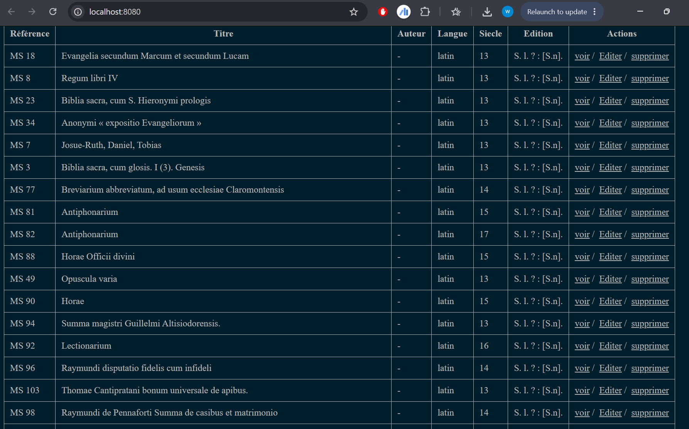

> CAPTURE 3 : `captures/03_pagination.png`**
> Le bas de la page avec « Page X / 141 (2818 manuscrits) » et les liens Première / Précédente / Suivante / Dernière.

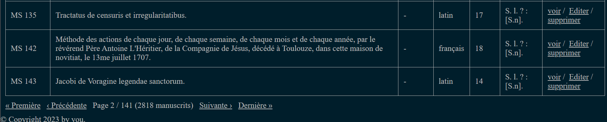

### 2.4 CRUD

| Opération | Fichier | Méthode MongoDB |
|---|---|---|
| **C**reate : ajout d'un manuscrit | `create.php` + `create.html.twig` | `insertOne()` |
| **R**ead : fiche détail | `get.php` + `get.html.twig` | `findOne(['_id' => new ObjectId($id)])` |
| **U**pdate : formulaire pré-rempli puis enregistrement | `edit.php` + `update.html.twig` ? `update.php` | `updateOne([...], ['$set' => [...]])` |
| **D**elete : suppression | `delete.php` | `deleteOne()` |

Après un ajout, l'utilisateur est redirigé vers la fiche du livre créé (`get.php?id=<insertedId>`). Cela a été réutilisé dans le scénario k6 pour récupérer l'identifiant du livre créé.

> CAPTURE 4 : `captures/04_detail.png`**
> La fiche détail d'un manuscrit (`get.php?id=...`).

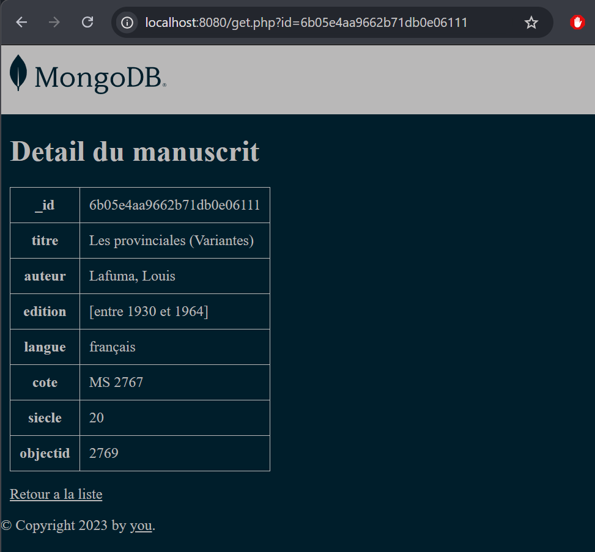

> CAPTURE 5 : `captures/05_ajout.png`**
> Le formulaire « Ajouter un manuscrit » rempli.

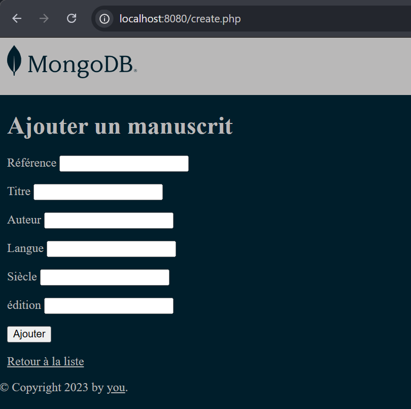

> CAPTURE 6 : `captures/06_edition.png`**
> Le formulaire de modification pré-rempli (`edit.php?id=...`).

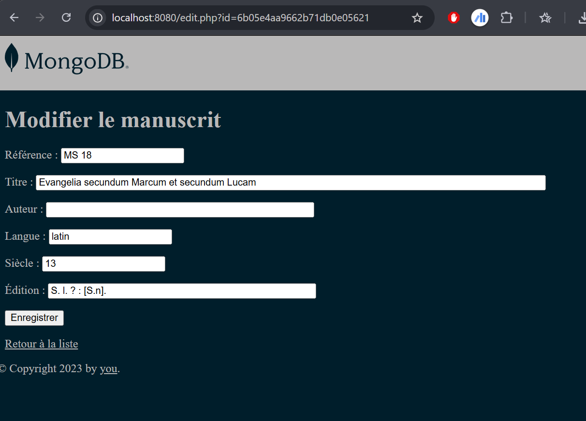

---

## 3. TP2 : Redis, cache applicatif et tests de charge

### 3.1 Configuration

La librairie **predis/predis** a été ajoutée avec Composer. Trois variables ont été ajoutées au `.env` :

```
REDIS_HOST=tpmongo-redis
REDIS_PORT=6379
REDIS_ENABLE=true
```

`REDIS_ENABLE` sert d'**interrupteur** : il permet de comparer l'application avec et sans cache, sans modifier le code. Le `.env` est relu à chaque requête, donc aucun redémarrage n'est nécessaire.

```php
function getRedisClient(): ?Predis\Client
{
    if (($_ENV['REDIS_ENABLE'] ?? 'false') !== 'true') {
        return null;
    }
    return new Predis\Client([
        'scheme' => 'tcp',
        'host'   => $_ENV['REDIS_HOST'],
        'port'   => (int) $_ENV['REDIS_PORT'],
    ]);
}
```

### 3.2 Ce qui est mis en cache

Nous avons appliqué le pattern **cache-aside** : l'application lit d'abord Redis ; si la clé est absente, elle interroge MongoDB et stocke le résultat avec une durée de vie de 300 secondes (`SETEX`).

| Clé Redis | Contenu | Pourquoi |
|---|---|---|
| `manuscrits:count` | Nombre total de documents | Utilisé à chaque affichage pour calculer le nombre de pages |
| `manuscrits:liste:page:N` | Les 20 documents de la page N (sérialisés) | La liste est la page la plus consultée |

Une première version utilisait une **clé unique** pour toute la liste. Avec la pagination, elle renvoyait toujours la page 1 : il faut **une clé par variante** de la donnée.

**Invalidation :** à chaque ajout, modification ou suppression, toutes les clés du préfixe `manuscrits:` sont supprimées, ce qui évite d'afficher une liste périmée :

```php
function clearListCache(): void
{
    $redis = getRedisClient();
    if ($redis && ($keys = $redis->keys('manuscrits:*'))) {
        $redis->del($keys);
    }
}
```

> CAPTURE 7 : `captures/07_redis_commander.png`**
> Redis Commander (http://localhost:8081) avec `KEYS manuscrits:*` et `GET manuscrits:count` ? `"2818"`, montrant le cache rempli.

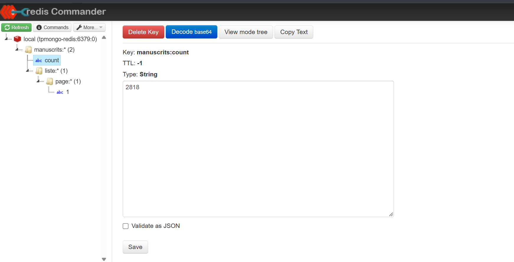

### 3.3 Scénario de test k6

Le script `k6/load_test.js` simule des utilisateurs réalistes. Chaque itération enchaîne :

1. affichage de la liste (et extraction des identifiants depuis le HTML par expression régulière) ;
2. affichage d'une page aléatoire (`?page=1..141`) ;
3. consultation de la fiche d'un livre pris au hasard dans la liste ;
4. dans **10 % des cas** : ajout d'un livre, puis **suppression de ce même livre** (identifiant récupéré dans l'URL de redirection), afin de ne pas altérer les données.

Montée en charge : 5 ? 10 ? **50 utilisateurs virtuels** puis redescente, pendant environ 36 secondes, avec une pause d'une seconde entre chaque action.

Commandes utilisées :

```bash
# REDIS_ENABLE=false
docker compose run --rm tpmongo-k6 run /scripts/load_test.js | tee test_no_cache.txt
# REDIS_ENABLE=true
docker compose run --rm tpmongo-k6 run /scripts/load_test.js | tee test_cache.txt
```

Les logs complets sont dans le dépôt : [`test_no_cache.txt`](test_no_cache.txt) et [`test_cache.txt`](test_cache.txt).

### 3.4 Résultats

| Métrique | Sans cache | Avec cache | Écart |
|---|---|---|---|
| Checks réussis | 100 % (526) | 100 % (518) | n/a |
| Durée moyenne (`avg`) | 27,25 ms | **14,84 ms** | **?46 %** |
| Médiane | 10,46 ms | 10,38 ms | ? 0 % |
| p(90) | 29,11 ms | **20,82 ms** | ?28 % |
| p(95) | 48,94 ms | **36,31 ms** | ?26 % |
| Maximum | 1,08 s | **437 ms** | ?60 % |
| Minimum | **1,70 ms** | 2,82 ms | +66 % |
| Requêtes / seconde | 13,4 | 13,4 | n/a |
| Itérations | 166 | 166 | n/a |

> CAPTURE 8 : `captures/08_grafana_sans_cache.png`**
> Le tableau de bord k6 dans Grafana (http://localhost:3000) sur la période du test **sans cache**.
> (Les panneaux « Virtual Users », « Errors » et « Checks » du tableau de bord importé n'affichent pas de données avec cette version de Grafana. Les panneaux de requêtes et de `http_req_duration` sont fonctionnels.)

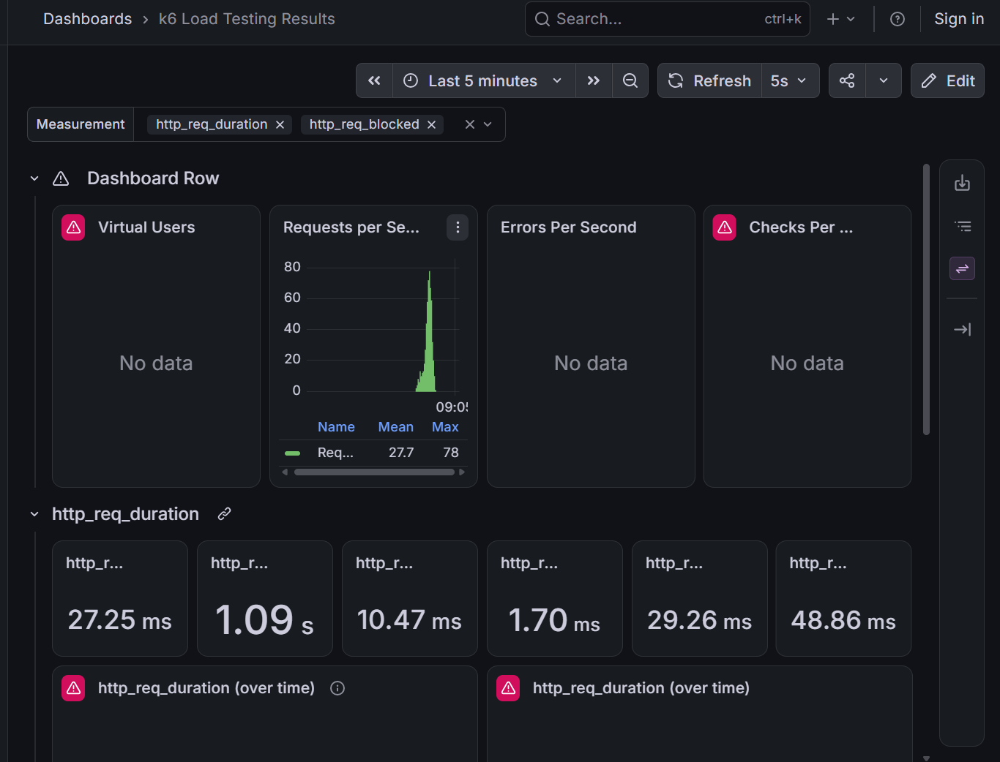

> CAPTURE 9 : `captures/09_grafana_avec_cache.png`**
> Le même tableau de bord sur la période du test **avec cache**.

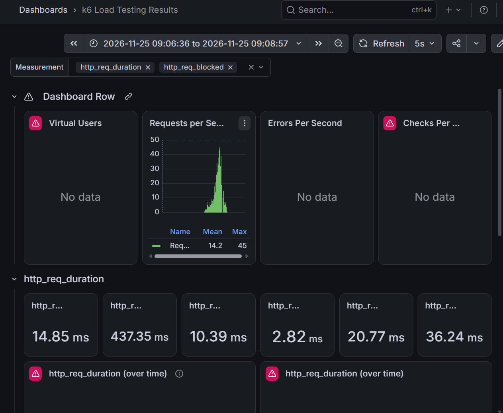

### 3.5 Analyse

Les deux tests sont **fonctionnellement corrects** (100 % de checks) et traitent le même volume (166 itérations, environ 13,4 requêtes par seconde, ce débit étant fixé par les pauses du scénario). La différence porte donc uniquement sur les temps de réponse.

**Ce que le cache améliore : les requêtes lentes.** La durée moyenne baisse de 46 %, le p(95) de 26 % et le pire cas passe de 1,08 s à 437 ms. Sans cache, au pic de 50 utilisateurs, toutes les requêtes de liste et de comptage arrivent simultanément sur MongoDB et certaines doivent attendre. Avec le cache, une partie d'entre elles est servie directement depuis la mémoire de Redis, ce qui réduit la file d'attente.

**Ce qu'il n'améliore pas : la requête typique.** La médiane est identique (? 10,4 ms) et le temps minimum est même plus élevé avec le cache (2,82 ms contre 1,70 ms). Quand la charge est faible, MongoDB répond déjà en quelques millisecondes : ses 2818 documents tiennent en mémoire dans son cache interne. Redis ajoute alors un aller-retour réseau, la sérialisation PHP et l'ouverture d'une connexion (`getRedisClient()` crée un nouveau client à chaque appel).

**Pourquoi le gain reste limité :**
1. **Le cache est invalidé très souvent.** Environ 10 % des itérations ajoutent puis suppriment un livre, soit une trentaine de vidages complets du cache pendant le test. Après chaque vidage, les requêtes suivantes paient trois opérations (lecture Redis ratée, requête MongoDB, écriture Redis) au lieu d'une.
2. **141 pages tirées au hasard.** Chaque page doit être lue une première fois avant d'être en cache, donc une même page est rarement servie deux fois entre deux vidages.
3. **La charge reste modérée** (13 requêtes par seconde) et ne sature pas MongoDB.

**Variabilité des mesures.** Une première campagne de tests, réalisée la veille dans les mêmes conditions, avait donné la tendance inverse sur la moyenne (14,7 ms sans cache contre 19,7 ms avec). Sur une machine personnelle (Docker sous WSL), une seule exécution de 36 secondes est sensible au bruit : premières requêtes à froid, autres processus actifs. Pour conclure de façon fiable, il faudrait répéter chaque test plusieurs fois et comparer les médianes des résultats.

**Conclusion :** le cache **stabilise l'application sous charge** (moins de requêtes lentes, pire cas divisé par 2,5), mais il n'accélère pas la requête typique. Il est d'autant plus rentable que son **taux de succès est élevé** (beaucoup de lectures pour peu d'écritures) et que la source de données est **lente** (requêtes complexes, gros volumes, API distante).

<!-- Si vous avez fait le test en lecture seule (WRITE_RATIO=0), ajoutez ici une ligne au tableau
     et la capture captures/10_k6_lecture_seule.png ; sinon supprimez ce commentaire. -->

**Améliorations possibles :**
- **Invalidation ciblée** : avec un tri par `_id`, un ajout ne modifie que la dernière page et le total. Inutile de vider tout le cache.
- **Mettre en cache la fiche détail** (`manuscrit:{id}`), supprimée uniquement quand ce livre est modifié.
- **Réutiliser une connexion Redis** unique par requête.

---

## 4. TP3 : ElasticSearch, moteur de recherche

### 4.1 Configuration

La librairie `elasticsearch/elasticsearch:^8.0` est utilisée. L'hôte est défini dans le `.env` (`ELASTIC_HOST="http://tpmongo-elasticsearch:9200"`) et le client est créé dans `init.php` :

```php
function getElasticSearchClient(): \Elastic\Elasticsearch\Client
{
    return \Elastic\Elasticsearch\ClientBuilder::create()
        ->setHosts([$_ENV['ELASTIC_HOST']])
        ->build();
}
```

### 4.2 Indexation (`command/indexation.php`)

Le script (re)crée l'index `manuscrits` avec un **analyseur français personnalisé**, puis envoie les documents MongoDB par paquets de 500 avec l'API **bulk**. L'`_id` MongoDB est réutilisé comme identifiant ElasticSearch, ce qui permet de faire le lien entre les deux bases.

```bash
docker exec -w /var/www/app tpmongo-php php command/indexation.php
# ? 2818 documents indexés dans 'manuscrits'
```

Chaîne de l'analyseur `fr`, appliquée aux champs `titre` et `auteur` :

| Étape | Filtre | Effet | Exemple |
|---|---|---|---|
| 1 | `standard` (tokenizer) | Découpage en mots | `L'Éloges` `de` `Blaise` `Pascal` |
| 2 | `elision` | Supprime l', d', qu'? | `Éloges` ? |
| 3 | `lowercase` | Minuscules | `éloges` `de` `blaise` `pascal` |
| 4 | `asciifolding` | Supprime les accents | `eloges` ? |
| 5 | `stop` (_french_) | Supprime les mots vides | `eloges` `blaise` `pascal` |
| 6 | `stemmer` (light_french) | Réduit à la racine | `elog` `blais` `pascal` |

> CAPTURE 10 : `captures/10_es_count.png`**
> http://localhost:9200/manuscrits/_count ? `{"count":2818,...}` (ou l'index dans Elasticvue).


> CAPTURE 11 : `captures/11_kibana_analyze.png`**
> Kibana ? Dev Tools, résultat de :
> `POST manuscrits/_analyze { "analyzer": "fr", "text": "L'Éloges de Blaise Pasqalsss", "explain": true }`
> (on y voit les tokens après chaque filtre).

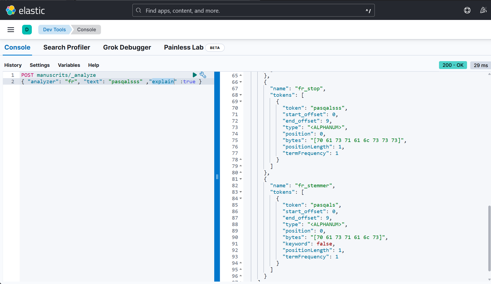

### 4.3 La requête de recherche

Un formulaire GET (`?q=...`) a été ajouté au-dessus de la liste. Quand des mots-clés sont saisis, `app.php` interroge ElasticSearch :

```php
'query' => ['bool' => ['should' => [
    ['match' => ['titre'  => ['query' => $q, 'fuzziness' => 'AUTO', 'boost' => 2]]],
    ['match' => ['auteur' => ['query' => $q, 'fuzziness' => 'AUTO']]],
]]]
```

| Exigence du TP | Solution |
|---|---|
| Rechercher sur le titre **et** l'auteur | `bool` / `should` avec deux `match` |
| Tolérer les fautes de frappe | `fuzziness: AUTO` (distance de Levenshtein : 0 erreur jusqu'à 2 lettres, 1 de 3 à 5, 2 à partir de 6) |
| Trouver le singulier à partir du pluriel | Stemmer `light_french`, appliqué **à l'indexation et à la requête** |
| Paramètre `boost` | Le titre pèse **deux fois plus** que l'auteur dans le score |

**Lien avec MongoDB :** ElasticSearch ne renvoie que les **identifiants** (`_source: false`) des 20 résultats de la page (`from` / `size`). Les documents sont ensuite chargés depuis MongoDB (`$in`), puis remis dans l'**ordre de pertinence**. MongoDB reste ainsi la source de vérité. La pagination conserve le paramètre `q` dans ses liens.

**Classement :** le score est calculé par l'algorithme **BM25**. Dans une clause `should`, les scores des deux champs **s'additionnent** : un livre qui contient « Pascal » à la fois dans son titre et dans son auteur (par exemple *« Chez les anciens du Lycée Blaise Pascal »*) arrive donc en tête.

### 4.4 Démonstrations

> CAPTURE 12 : `captures/12_recherche_titre.png`**
> Recherche `Missale` (mot du titre).

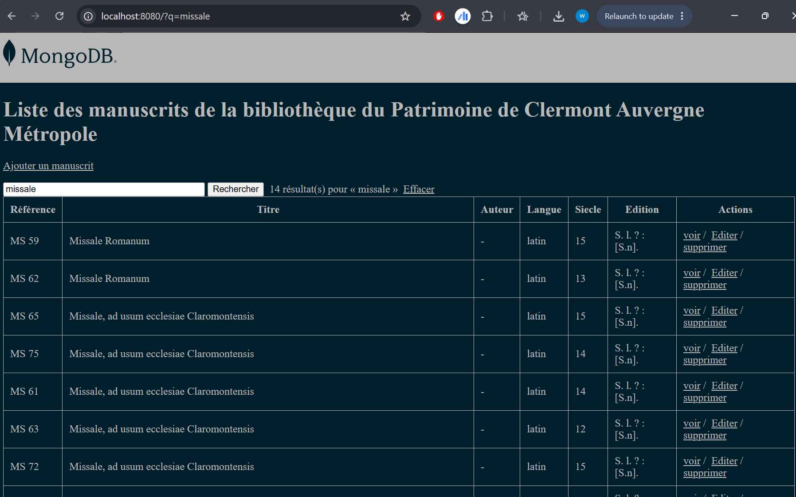

> CAPTURE 13 : `captures/13_recherche_auteur.png`**
> Recherche `Lafuma` (nom d'auteur).

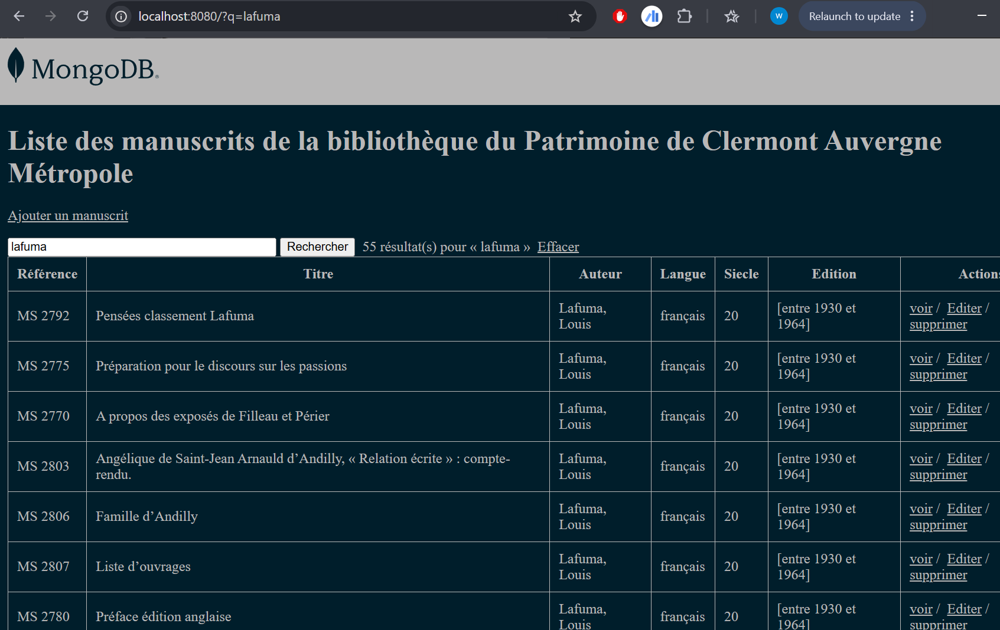

> CAPTURE 14 : `captures/14_recherche_faute.png`**
> Recherche `paskal` ? 30 résultats contenant « Pascal » (faute de frappe tolérée).

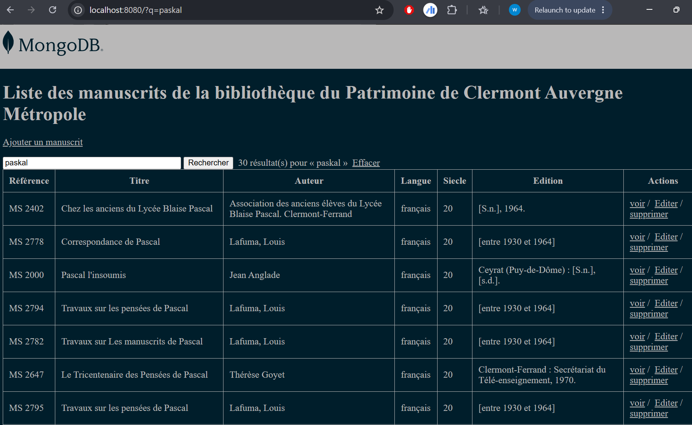

> CAPTURE 15 : `captures/15_recherche_pluriel.png`**
> Recherche `éloges` ? « Éloge de Blaise Pascal » est trouvé (pluriel ? singulier).

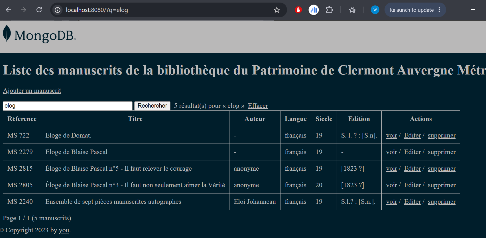

**Cas intéressant :** la recherche `pasqalsss` renvoie aussi des résultats, alors qu'elle semble contenir plus de deux erreurs. Le terme est d'abord **analysé** : le stemmer retire le `s` final du pluriel et réduit les lettres doublées, ce qui donne `pasqals`. Il ne reste alors que **2 modifications** pour obtenir `pascal` (`q`?`c`, suppression du `s`), ce qui est toléré pour un mot de 7 lettres. La tolérance s'applique donc **après** l'analyse. Une valeur plus stricte (`fuzziness: "AUTO:4,8"`) n'accepterait qu'une erreur pour les mots de 4 à 7 lettres.

> CAPTURE 16 : `captures/16_kibana_explain.png`**
> Kibana ? `GET manuscrits/_search` avec `"explain": true` pour `pasqalsss`, montrant le terme trouvé (`titre:pascal`), le calcul BM25 et le boost.


### 4.5 Limite

Les ajouts, modifications et suppressions faits depuis l'application sont écrits dans MongoDB mais **pas répercutés dans ElasticSearch** tant que `indexation.php` n'est pas relancé. Les documents supprimés sont filtrés à l'affichage (absents de MongoDB), mais un nouveau livre n'est pas trouvable par la recherche. L'amélioration consiste à appeler `index()` dans `create.php` et `update.php`, et `delete()` dans `delete.php`.

---

## 5. Problèmes rencontrés et solutions

| # | Problème | Cause | Solution |
|---|---|---|---|
| 1 | `localhost:8080` inaccessible (*connection refused*) | Les conteneurs d'un autre TP (Symfony) occupaient les ports 8080 et 8081, donc `tpmongo-php` et `redis-commander` ne démarraient pas | `docker stop tp-ws-api phpmyadmin tp-ws-db` puis `docker compose up -d` |
| 2 | Liste vide alors que le code était correct | MongoDB n'a **pas de volume** dans le `docker-compose.yml` : la base est effacée quand le conteneur est recréé | Ré-import avec le `mongoimport` du conteneur. Utiliser `docker compose stop` au lieu de `down` |
| 3 | « R?f?rence » dans l'en-tête du tableau | Mot abîmé par un copier-coller (mauvais encodage) | Mot retapé, fichier enregistré en UTF-8 |
| 4 | Le cache renvoyait toujours la même page | Clé Redis unique pour toute la liste | Une clé par page : `manuscrits:liste:page:N` |
| 5 | Liste périmée après modification ou suppression | Seul `create.php` vidait le cache | Fonction `clearListCache()` appelée dans create, update et delete |
| 6 | `edit.php` affichait le texte d'exemple, puis du code PHP brut | Fichier non implémenté, puis contenu de `update.php` collé par erreur sans balise `<?php` valide | Réécriture de `edit.php`, `update.html.twig` et `update.php` avec des noms de champs cohérents |
| 7 | Erreur HTTP 500 sans message à la suppression | Erreur de syntaxe PHP : le parseur échoue avant que `display_errors` soit actif | Diagnostic avec `php -l` et `var/log/error.log` |
| 8 | Le script k6 ne pouvait pas joindre l'application | Le script de départ appelait `http://php:80` alors que le service s'appelle `tpmongo-php` | `BASE = "http://tpmongo-php:80"` |
| 9 | `git push` vers GitLab en échec (HTTP 504) | Un paquet `mangodb-tools.deb` de 69 Mo avait été commité | `git reset --soft`, `git rm --cached`, `*.deb` ajouté au `.gitignore` ? envoi de 153 Ko |

---

## 6. Conclusion et apprentissages

Ces trois TP montrent que chaque technologie NoSQL répond à un besoin précis et qu'elles se **complètent** plutôt qu'elles ne se remplacent :

- **MongoDB stocke** : schéma souple adapté à des données hétérogènes (beaucoup d'auteurs sont absents, certains champs varient), API simple pour le CRUD et la pagination.
- **Redis accélère**, mais pas partout. Le test de charge montre que le cache réduit fortement les requêtes lentes sous charge (?46 % sur la moyenne, pire cas divisé par 2,5) sans changer la requête typique, déjà rapide avec MongoDB. Deux campagnes de mesures aux tendances différentes nous ont aussi appris qu'il faut **mesurer plusieurs fois** avant de conclure qu'une optimisation est utile.
- **ElasticSearch trouve** : grâce à l'analyse linguistique (racinisation, suppression des accents et des mots vides), à la distance de Levenshtein et au score BM25 pondéré par le `boost`, il fournit une recherche pertinente qu'une requête MongoDB classique ne permettrait pas. En contrepartie, il faut **maintenir l'index synchronisé** avec la base principale.
- **k6, InfluxDB et Grafana mesurent** : un scénario réaliste et reproductible est indispensable pour comparer objectivement deux versions.

Sur le plan pratique, ces TP nous ont aussi appris une méthode de diagnostic dans un environnement conteneurisé : vérifier l'état des conteneurs (`docker ps -a`, `docker logs`), vérifier les **données** avant le code, lire les journaux d'erreurs (`php -l`, `error.log`), et utiliser les noms de services Docker plutôt que `localhost`.

---

## 7. Annexe : relancer le projet

```bash
docker compose up -d
docker exec -w /var/www/app tpmongo-php composer install

# si la base est vide (pas de volume MongoDB / ElasticSearch)
docker cp catalogue-manuscrits-bibliotheque-patrimoine.json tpmongo-mongodb:/tmp/data.json
docker exec tpmongo-mongodb mongoimport -u zz3f3 -p easyma --authenticationDatabase admin \
       --db tp --collection tp --file /tmp/data.json --jsonArray
docker exec -w /var/www/app tpmongo-php php command/indexation.php

# arrêter sans perdre les données
docker compose stop
```

| URL | Outil |
|---|---|
| http://localhost:8080 | Application |
| http://localhost:4321 | Mongo GUI |
| http://localhost:8081 | Redis Commander |
| http://localhost:3000 | Grafana |
| http://localhost:9200 | ElasticSearch |
| http://localhost:5601 | Kibana |
| http://localhost:8180 | Elasticvue |